# [최종 보고서] 진선미 재가장기요양기관 웹사이트 구축 및 화면 구성 완료 보고서

**수신**: 진선미 재가장기요양기관 원장님 및 관계자 제위  
**발신**: 웹 구축 전담 개발팀  
**작성일자**: 2026년 10월 22일 (최종 구현 완료)  
**문서목적**: 진선미 재가장기요양기관 공식 웹사이트의 최종 구현 완료 내역, 화면별 상세 기능, 디자인 시스템 및 런칭 준비 사항 보고  

---

## 1. 프로젝트 개요 및 구축 성과

본 웹사이트는 어르신 돌봄이 필요한 보호자(40~60대 자녀 세대)와 어르신 본인 모두에게 **따뜻한 가족의 마음과 신뢰감**을 전달하고, 방문요양·방문목욕·가족요양 서비스 이용 및 장기요양등급 무료 대행 신청으로의 **즉각적인 문의(전화·카카오톡·간편접수)**를 극대화하도록 성공적으로 구축 완료되었습니다.

### 🎯 핵심 구축 성과
1. **공식 기관 신뢰도 및 인허가 정보 완벽 반영**:
   - 국민건강보험공단 공식지정 장기요양기관 지정번호(`제 2-42150-00101호`) 및 고유번호(`226-82-68045`) 명시
   - 사업장 소재지(강원특별자치도 강릉시 주문진읍 교항원길 39-2) 및 공식 대표전화(`033-662-0001`), 팩스(`033-662-0002`) 체계 확립
2. **센터장 & 시설장 2인 전문 프로필 체제 및 UI 최적화**:
   - **센터장 최미선**: 사회복지사 1급, 요양보호사 1급, CPR 자격증, 노인상담심리, 노인치매 관리자 보유 (직통 연결: `010-9970-4474`)
   - **시설장 이상현**: 사회복지사 1급, 요양보호사 1급, CPR, 노인치매관리자, 병원동행매니저, 노인돌봄생활지원사 (직통 연결: `010-3458-0518`)
   - **프로필 사진 UI 개선 완료**: 1:1 정사각 고화질 인물 중심 크롭(`choi_misun.jpg`, `lee_sanghyun.jpg`) 및 `80px × 80px` 대칭 프레임 적용으로 완벽한 시각적 균형 달성
3. **보호자 편의를 위한 3대 인터랙티브 기능 탑재**:
   - **2026년 최신 고시 수가 기준 본인부담금 모의계산기**: 등급별(1~5등급, 인지원) 및 감경유형(일반 15%, 감경 6~9%, 수급자 0%) 실시간 자동 연산
   - **3분 장기요양등급 자가진단 퀴즈**: 보행·식사·인지·돌봄공백 4문항 자가진단 및 맞춤형 예상 등급 판정
   - **대화형 지도 및 길안내 연동**: Leaflet 기반 주문진 센터 위치 지도와 네이버지도/카카오맵/길찾기 원클릭 연동
4. **온·오프라인 다이렉트 상담 체계 구축**:
   - 365일 24시간 긴급 전화상담(`033-662-0001`), 카카오톡 1:1 상담방 연동
   - Node.js 백엔드(`server.js`) 및 Formspree 이중 연동 기반의 **온라인 1:1 간편 상담 접수 폼** 구현

---

## 2. 디자인 시스템 (Design System)

| 구분 | 적용 내용 | 디자인 의도 및 특징 |
| :--- | :--- | :--- |
| **Primary Color** | `#0d402e` (포레스트 딥 그린) | 국민건강보험공단 공식지정기관으로서의 높은 공신력과 숲의 평온한 치유감 제공 |
| **Secondary Color**| `#a23f04` (웜 앰버 오렌지) | 보호자와 어르신에게 전하는 가족의 따뜻한 온기, 핵심 행동(전화걸기, 상담신청) 유도 |
| **Background** | `#faf9f6` (소프트 크림 아이보리)| 눈의 피로를 최소화하고 편안하고 온화한 인상을 주는 프리미엄 시니어 친화적 배경색 |
| **Typography** | Noto Sans KR (가변 폰트) | 40~60대 보호자 및 시니어 사용자를 위한 또렷하고 선명한 서체 위계 구성 |
| **Layout & Grid** | 반응형 모바일 퍼스트 UI | 스마트폰 터치에 최적화된 하단 탭 바 및 큰 터치 영역, 데스크톱 시원한 3단 그리드 |

---

## 3. 사이트맵 및 화면 아키텍처

```mermaid
graph TD
    Root["진선미 재가장기요양기관 공식 웹사이트"]
    
    Tab1["[탭 1] 홈 (Home)"]
    Tab2["[탭 2] 서비스안내 & 계산기"]
    Tab3["[탭 3] 등급신청 & 자가진단"]
    Tab4["[탭 4] 센터소개 & 상담"]
    
    Root --> Tab1
    Root --> Tab2
    Root --> Tab3
    Root --> Tab4
    
    Tab1 --> T1_Top["상단 긴급 안내 & 건보공단 공식인증"]
    Tab1 --> T1_Hero["따뜻한 히어로 배너 & 원클릭 상담"]
    Tab1 --> T1_Service["4대 맞춤돌봄 서비스 요약 카드"]
    Tab1 --> T1_Point["진선미 4대 특장점 (1급 요양보호사 100%)"]
    Tab1 --> T1_Step["이용 절차 4단계 가이드"]
    Tab1 --> T1_Reviews["보호자 실제 이용 후기 캐러셀"]
    
    Tab2 --> T2_Intro["맞춤 케어 4종 탭 (방문요양/목욕/가족/용구)"]
    Tab2 --> T2_Daily["표준 케어 일과표 타임라인 (09:00~12:00)"]
    Tab2 --> T2_Calc["★ 2026 장기요양 본인부담금 모의계산기"]
    
    Tab3 --> T3_Intro["등급신청 100% 무료 대행 안내 (승인율 96.8%)"]
    Tab3 --> T3_Process["건보공단 심사 4단계 절차"]
    Tab3 --> T3_Quiz["★ 3분 간편 자가진단 퀴즈 (즉시 등급 판정)"]
    Tab3 --> T3_Form["등급신청 간편 온라인 접수 폼"]
    
    Tab4 --> T4_Quick["원클릭 빠른 상담 (전화 / 카카오톡 1:1)"]
    Tab4 --> T4_Leaders["★ 센터장(최미선) & 시설장(이상현) 프로필"]
    Tab4 --> T4_Staff["전문 인력 구성 (1급 사회복지사 3인, 요양보호사 25명)"]
    Tab4 --> T4_Map["★ 오시는 길 (Leaflet 대화형 지도 & 네이버/카카오 길찾기)"]
    Tab4 --> T4_FAQ["자주 묻는 질문 (FAQ 아코디언)"]
    Tab4 --> T4_Consult["1:1 간편 상담 접수 (Node.js API 연동)"]
```



---

## 4. 화면별 구현 상세 내역

### 4.1. 홈 화면 (Home View)
- **상단 헤더 & 긴급 배너**:
  - 국민건강보험공단 공식지정 장기요양기관 인증 및 2026년도 신규 어르신 맞춤돌봄 무료상담 안내
  - 대표 상담전화(`033-662-0001`), 평일 운영시간 및 연중무휴 긴급상담 안내
- **감성적 히어로 배너**:
  - 대표 슬로건: *"부모님의 평온한 일상, 가족의 마음으로 곁에서 함께합니다"*
  - 원터치 무료 전화상담 및 카카오톡 진선미 공유방(1:1 오픈채팅) 바로가기
- **4대 맞춤돌봄 서비스 요약**: 방문요양, 방문목욕, 가족요양, 복지용구 대여 핵심 안내
- **진선미 4대 특장점**:
  1. 100% 국가공인 1급 전문 요양보호사 전담제 매칭
  2. 전담 사회복지사의 월 1회 이상 정기 가정방문 및 어르신 욕구 사정
  3. 보호자 안심 스마트 알림장 (식사, 투약, 건강상태 기록 제공)
  4. 맞춤형 신체·인지 재활 특화 프로그램 운영
- **서비스 이용 절차 4단계**: 상담접수 ➔ 방문상담 및 욕구사정 ➔ 급여계약 및 계획수립 ➔ 서비스 개시 및 정기 모니터링
- **실제 보호자 이용 후기**: 정성스러운 케어로 부모님의 건강이 호전된 실제 보호자 감사 후기 슬라이드

---

### 4.2. 서비스 안내 & 본인부담금 계산기 (Services & Calculator)
- **4대 서비스 필터 탭**: 방문요양 / 방문목욕 / 가족요양 / 복지용구 탭 전환 시 상세 설명 제공
- **3대 전문 케어 영역 상세화**:
  - **신체활동 지원**: 세면 및 구강청결, 식사 및 복약 보조, 체위 변경, 화장실 이용 동행
  - **일상생활 지원**: 어르신 맞춤 식사 준비, 주변 환경 및 침구 정리, 세탁 지원
  - **개인활동 및 정서 지원**: 병원 진료 동행, 관공서 외출 동행, 말벗 및 인지자극 프로그램
- **표준 하루 케어 일과표**: 09:00 건강체크부터 12:00 정서 교감까지 3~4시간 표준 스케줄 시각화
- **2026년 장기요양 국비지원 모의계산기**:
  - **등급 선택**: 1등급(월 한도 2,069,900원), 2등급(1,869,600원), 3등급(1,453,100원), 4등급(1,341,800원), 5등급(1,151,600원), 인지원등급(631,600원)
  - **본인부담률 선택**: 일반(15%), 감경대상(9%), 차상위(6%), 기초생활수급자(0% 전액 국비지원)
  - **실시간 결과 산출**: 월 최대 정부지원금과 실제 본인부담금을 원 단위로 즉시 계산

---

### 4.3. 등급신청 & 3분 자가진단 (Grade Check & Self Diagnosis)
- **장기요양등급 100% 무료 대행 안내**:
  - 복잡한 건보공단 서류 제출부터 방문조사 현장 동행까지 진선미가 전액 무료 대행
  - 등급 승인율 96.8% 달성 성과 강조
- **건보공단 심사 4단계 절차 가이드**: 1. 인정신청서 제출 ➔ 2. 공단 직원 방문조사 ➔ 3. 의사소견서 제출 ➔ 4. 등급판정위원회 판정
- **인터랙티브 3분 자가진단 퀴즈**:
  - 4대 핵심 문진(어르신 보행 거동 능력, 식사 및 배설 자립도, 인지 기억력 상태, 주 돌봄자 공백 여부)
  - 문진 완료 시 예상 인정 등급과 권장 맞춤 케어 시간 즉시 출력
- **등급신청 간편 접수 폼**: 어르신 성함, 보호자 연락처, 주소지 입력 후 1초 접수

---

### 4.4. 센터소개 & 상담 (About & Contact View)
- **3대 빠른 상담 액션 창구**: 전화연결(`033-662-0001`), 카카오톡 1:1 상담방, 1:1 온라인 상담신청
- **센터장 & 시설장 프로필**:
  - **최미선 센터장**: 사회복지사 1급, 요양보호사 1급, CPR, 노인상담심리, 노인치매관리자 (`010-9970-4474`)
  - **이상현 시설장**: 사회복지사 1급, 요양보호사 1급, CPR, 노인치매관리자, 병원동행매니저, 노인돌봄생활지원사 (`010-3458-0518`)
  - **프로필 사진 최적화**: 80px × 80px 규격, 고화질 상반신 크롭, 인증 뱃지 적용
- **공식 자격 및 보건복지부 등록 현황**:
  - 사회복지사 1급 3인 상주 (최미선 / 이상현 / 이상록)
  - 전문 요양보호사 25명 (전원 1급 자격 보유, 치매전문교육 이수)
  - CPR·소방응급 분기별 100% 안전 교육 이수 및 전문인배상책임보험 가입 완료
- **오시는 길 & 대화형 지도 (Leaflet)**:
  - 강원특별자치도 강릉시 주문진읍 교항원길 39-2 (진선미센터)
  - 인터랙티브 지도 확대/축소 및 카카오맵, 네이버지도, 길찾기 다이렉트 버튼 탑재
  - 주문진 시외버스터미널 도보 10분, 센터 앞 전용 주차장 완비 안내
- **1:1 간편 온라인 상담 접수 폼**:
  - 신청인 성함, 연락처(자동 하이픈 입력), 문의 분야(방문요양/등급신청/가족요양/복지용구), 메모 입력
  - Node.js 서버(`server.js`) 백엔드 API 연동 완료
- **자주 묻는 질문 (FAQ)**: 비용, 요양보호사 매칭 및 교체, 주말 케어, 타 직장 재직 중 가족요양 등 핵심 질문 4종 답변

---

## 5. 최종 구현 완료 검증 체크리스트

| 검증 항목 | 상세 내용 | 상태 |
| :--- | :--- | :---: |
| **기관 인허가 정보** | 지정번호(제 2-42150-00101호), 고유번호(226-82-68045), 팩스(033-662-0002) 정상 표기 | ✅ 완료 |
| **센터장/시설장 프로필** | 최미선 센터장 및 이상현 시설장 직통 전화 연결, 실제 자격사항 반영 | ✅ 완료 |
| **프로필 이미지 UI** | 1:1 정사각 고화질 크롭, `w-20 h-20` (80px × 80px) 동일 규격 적용 | ✅ 완료 |
| **본인부담금 계산기** | 2026년 고시 수가 기준 등급별·감경유형별 실시간 자동 연산 정상 작동 | ✅ 완료 |
| **등급 자가진단 퀴즈** | 4문항 체크 및 결과 도출 인터랙션 정상 작동 | ✅ 완료 |
| **대화형 지도 연동** | Leaflet 지도 마커 정상 표출 및 카카오/네이버 지도 다이렉트 링크 연동 | ✅ 완료 |
| **온라인 상담 접수 API**| Node.js 서버(`POST /api/consult`) 접수 처리 및 백엔드 로그 연동 완료 | ✅ 완료 |
| **반응형 모바일 UI** | 모바일 하단 탭 바, 터치 최적화, 데스크톱 고해상도 레이아웃 검증 완료 | ✅ 완료 |

---

## 6. 향후 런칭 일정 및 오픈 로드맵

```
[완료] 1단계: 웹사이트 기획, 디자인 및 전체 기능 구현 완료
  ↓
[완료] 2단계: 최미선 센터장 & 이상현 시설장 프로필 최적화 및 인허가 정보 반영
  ↓
[완료] 3단계: GitHub 배포 준비 (프로젝트 불필요 파일 정리, .gitignore, README.md 구축)
  ↓
[진행] 4단계: 도메인 확정 (jinseonmicare.kr / jsmcare.kr) 및 네이버/카카오 포털 검색등록
  ↓
[최종] 5단계: 공식 오픈 및 온라인 마케팅 개시
```

---

*본 웹사이트는 모든 기능 구현과 검증이 완료되어 즉시 실 서비스 배포 및 운영이 가능한 상태입니다.*
